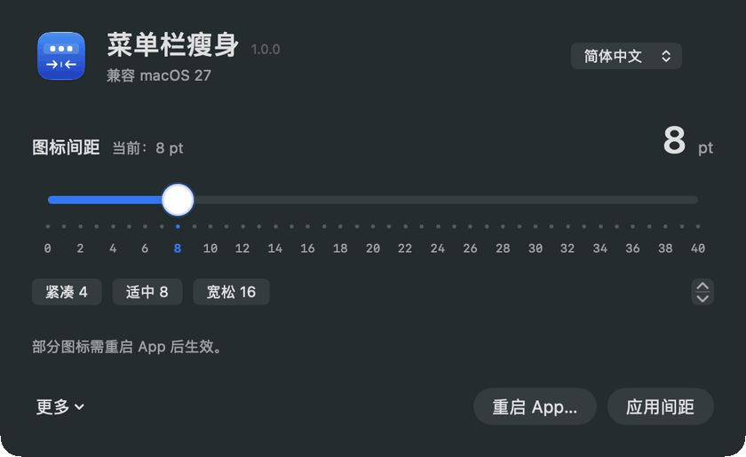

<p align="center"></p>

# MenuSlim 1.0.0

**A Mac menu bar / status bar icon spacing utility. Make room for your icons.**

Compatible with **macOS 27** · English / 简体中文 · Apple Silicon · MIT

[简体中文](README.md) · [Compatibility results](docs/COMPATIBILITY.md)

**[⬇ Download MenuSlim 1.0.0 for Apple Silicon (DMG)](https://github.com/oysgg/MenuSlim/releases/download/v1.0.0-build2/MenuSlim-1.0.0-macOS-arm64.pkg)** · [All releases](https://github.com/oysgg/MenuSlim/releases)

Double-click the PKG and follow the macOS Installer steps. Then open MenuSlim from Applications. An administrator password may be required. For Apple Silicon, tested on macOS 27.0.1; the package has not been notarized by Apple.

Prefer drag-to-install? Use the [DMG](https://github.com/oysgg/MenuSlim/releases/download/v1.0.0-build2/MenuSlim-1.0.0-macOS-arm64.dmg) and drag the app onto Applications as indicated by the arrow. Opening the DMG or its app does not copy it automatically.

A small native SwiftUI utility for menu bar spacing: a damped 0–40 pt slider, exact numeric ticks, presets, keyboard adjustment and restoration of your original settings. No third-party dependencies, networking or uploads.

- Refreshes known system components, including enabled Weather and input menu items.
- Offers a separate, confirmed relaunch of regular apps. Save your work first; apps are not force-quit.
- Compares actual menu item bounds before and after applying a value.
- Follows your system language, with an instant Chinese / English override.

> **macOS 27 compatibility does not mean every system icon is adjustable.** Weather and the input menu have shown changes; Clock, Control Center and Battery did not change in current testing. See the [compatibility table](docs/COMPATIBILITY.md).

## Demo



Recorded from the app window while switching between 8, 16 and 4 pt presets. This shows the configuration controls; Apply was not clicked and the animation does not demonstrate system icon changes. Regular apps typically need to be relaunched after applying. See the [measured compatibility results](docs/COMPATIBILITY.md) for system items.

## Use

**Apply & relaunch** saves the spacing shown in the confirmation before asking apps to quit. A write failure aborts the relaunch. Only reopened apps with a different process ID count as successfully relaunched.

Open `MenuSlim.app`, choose a value and apply. If a regular app has not picked up the setting, save your work and click **Apply & relaunch** next to **Apply spacing**. Apps that quit after the timeout must be reopened manually.

**More → Measure results** requires Accessibility access; spacing adjustment does not. Access is never enabled automatically. Measurements describe item bounds, not the transparent padding inside an icon. The slider represents a system preference value, not the exact visible gap between every pair of icons.

**More → Restore original settings** restores both preferences saved before your first application. Closing the window quits the app.

## Build

Using installed Apple Command Line Tools:

```sh
zsh build.sh /absolute/output/directory
zsh Tests/run.sh
# Package the built application as a DMG
zsh Tools/package_dmg.sh /absolute/output/directory/MenuSlim.app /absolute/output/directory/MenuSlim-1.0.0-macOS-arm64.dmg
zsh Tools/package_pkg.sh /absolute/output/directory/MenuSlim.app /absolute/output/directory/MenuSlim-1.0.0-macOS-arm64.pkg
```

Produces `MenuSlim.app` and an icon PNG. Target: arm64 / macOS 14+, tested on macOS 27.0.1 only. Measurement currently supports macOS 27. Builds are ad-hoc signed and not notarized.

Translations live in `Resources/{en,zh-Hans}.lproj`; `Tools/render_icon.swift` renders the icon. Tests cover geometry comparison, recovery, translation keys and format placeholders.

## Preferences and diagnostics

The app writes current-user, current-host `NSStatusItemSpacing`. Below 16, `NSStatusItemSelectionPadding` is `max(2, min(value - 2, 10))`; otherwise the override is removed. These preferences are not a public macOS API and may change in future releases.

Refreshing briefly restarts ControlCenter, SystemUIServer, TextInputMenuAgent and enabled WeatherMenu. macOS relaunches Weather itself to avoid duplicate instances. The existing bundle ID and backup path are retained for upgrades: `~/Library/Application Support/com.yangshuai.MenuSpacing/original.plist`.

Read-only measurement:

```sh
'/path/to/MenuSlim.app/Contents/MacOS/MenuSpacing' --audit
```

Opt-in 0 / 8 / 24 regression, temporarily changing preferences and refreshing system components:

```sh
python3 Tools/check_layout.py '/path/to/MenuSlim.app/Contents/MacOS/MenuSpacing' --run
```

The script attempts to restore original values and refuses to overwrite detected concurrent edits. An interrupted run retains `_project/tmp/test/menu-spacing/layout/preferences.json`; `null` means unset. Verify and restore these values before removing that file. SIGKILL or power loss cannot guarantee automatic recovery.

[MIT License](LICENSE)
