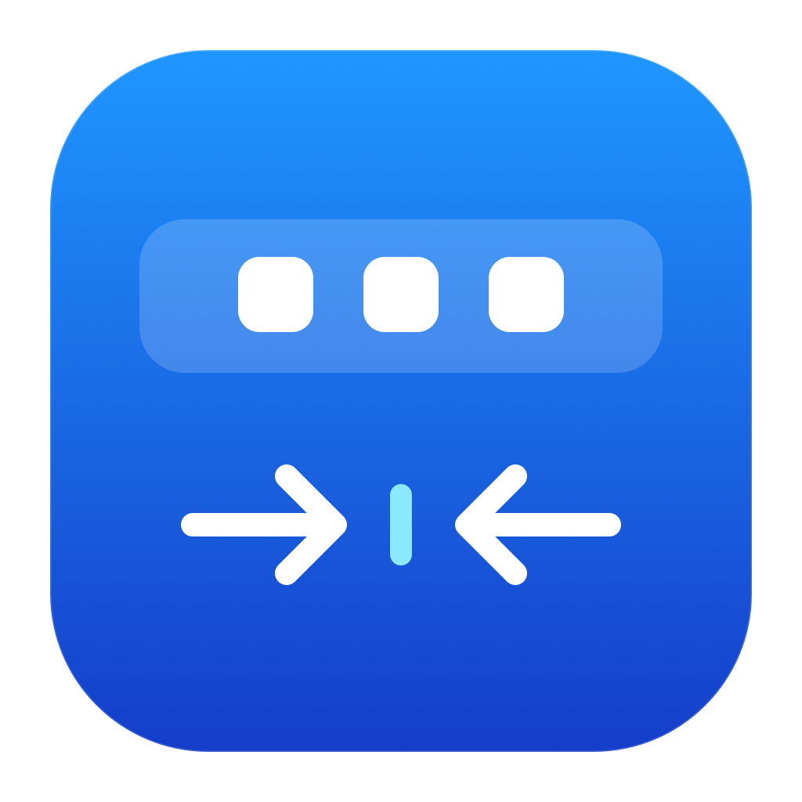
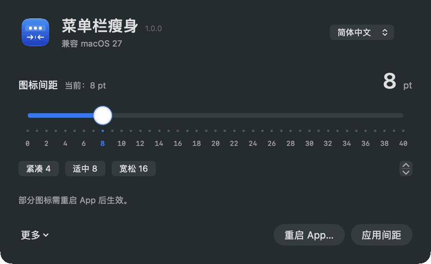

<p align="center"></p>

# 菜单栏瘦身 · MenuSlim 1.0.0

**Mac 菜单栏 / 状态栏图标间距调节工具，让图标排列更紧凑。**

兼容 **macOS 27** · 简体中文 / English · Apple Silicon · MIT

[English](README.en.md) · [兼容性实测](docs/COMPATIBILITY.md)

**[⬇ 下载 MenuSlim 1.0.0（PKG · Apple Silicon）](https://github.com/oysgg/MenuSlim/releases/download/v1.0.0/MenuSlim-1.0.0-macOS-arm64.pkg)** · [所有发布版本](https://github.com/oysgg/MenuSlim/releases)

推荐双击 PKG，跟随 macOS 安装向导完成安装，再到「应用程序」打开「菜单栏瘦身」。安装时系统可能要求管理员密码。适用于 M 系列 Mac，已在 macOS 27.0.1 验证；安装包尚未经过 Apple 公证。

习惯拖拽安装也可下载 [DMG](https://github.com/oysgg/MenuSlim/releases/download/v1.0.0/MenuSlim-1.0.0-macOS-arm64.dmg)，打开后按箭头将应用拖到 Applications。双击 DMG 或里面的 `.app` 只会打开，不会自动完成拷贝。

菜单栏（也常称状态栏）图标之间留白太大，想让它们靠近一点？菜单栏瘦身提供带数字刻度的间距滑条，支持微调、预设和恢复原设置。SwiftUI 原生界面，无第三方依赖，不联网、不上传数据。

- **0–40 pt 调节**：阻尼滑条、整数吸附、键盘微调。
- **刷新菜单项**：处理天气、输入菜单等独立组件；可单独选择重启普通 App。
- **自动对比**：读取前后实际占位，区分有变化、未变化与无法比较。
- **中英双语**：默认跟随系统，也可在界面即时切换。

> **兼容 macOS 27 不代表所有系统图标都可调整。** 天气和输入菜单已有生效验证；时钟、控制中心、电池等在当前实测中未变化。参见[兼容性表](docs/COMPATIBILITY.md)。

## 动态演示



实际应用窗口录制：切换 8、16、4 pt 预设，查看间距数值与滑条变化。演示未点击「应用间距」，不代表系统图标已经改变。普通 App 通常需要应用设置后重启；系统项效果见[兼容性实测](docs/COMPATIBILITY.md)。

## 使用

1. 打开 `MenuSlim.app`，选择间距，点击「应用间距」。
2. 普通应用未变化时，可保存工作后点击主界面的「重启 App」。不会强制退出；超时后才退出的应用需手动重新打开。
3. 「更多 → 检测实际效果」需要辅助功能权限。未授权仍可调整间距；软件不会自动开启权限。
4. 「更多 → 恢复使用前设置」恢复首次应用前的两项设置。

滑条显示系统偏好设置值，不保证任意两个图标的可见边缘距离相等。窗口关闭后退出程序。

## 构建

需要已安装的 Apple Command Line Tools：

```sh
zsh build.sh /absolute/output/directory
zsh Tests/run.sh
# 将已构建的应用打包为 DMG
zsh Tools/package_dmg.sh /absolute/output/directory/MenuSlim.app /absolute/output/directory/MenuSlim-1.0.0-macOS-arm64.dmg
zsh Tools/package_pkg.sh /absolute/output/directory/MenuSlim.app /absolute/output/directory/MenuSlim-1.0.0-macOS-arm64.pkg
```

输出 `MenuSlim.app` 和图标 PNG。构建目标为 arm64 / macOS 14+，目前仅验证 macOS 27.0.1；自动检测仅适配 macOS 27。构建产物使用本地 ad-hoc 签名，尚未公证。

## 开发

界面文案位于 `Resources/{zh-Hans,en}.lproj`；图标由 `Tools/render_icon.swift` 生成。`Tests/run.sh` 检查尺寸比较、设置恢复、双语目录和格式占位符。

间距使用当前用户、当前主机的 `NSStatusItemSpacing`。小于 16 时 `NSStatusItemSelectionPadding = max(2, min(value - 2, 10))`，否则移除该覆盖项。macOS 未公开保证这些设置，系统更新可能影响效果。

刷新会短暂重启 ControlCenter、SystemUIServer、TextInputMenuAgent 和已启用的 WeatherMenu。天气由系统自行拉起，避免重复打开。原设置保存在 `~/Library/Application Support/com.yangshuai.MenuSpacing/original.plist`；为兼容旧版，改名后保留原 bundle ID 和备份位置。

只读快照：

```sh
'/path/to/MenuSlim.app/Contents/MacOS/MenuSpacing' --audit
```

主动运行 0 / 8 / 24 档回归（会暂改间距并刷新系统组件）：

```sh
python3 Tools/check_layout.py '/path/to/MenuSlim.app/Contents/MacOS/MenuSpacing' --run
```

回归结束尝试恢复原值，遇到外部并发修改时不覆盖。异常中断的恢复值保留在 `_project/tmp/test/menu-spacing/layout/preferences.json`，`null` 表示原先未设置；核对并恢复后再删除此文件。SIGKILL 或断电无法保证自动恢复。

[MIT License](LICENSE)
